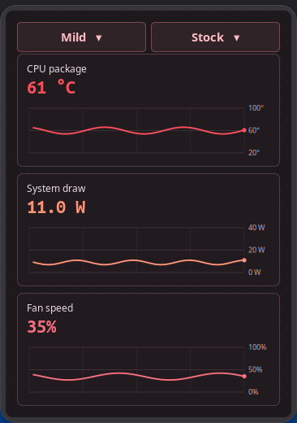

# MacBook Thermals

Click the thermometer in the GNOME panel to see CPU temperature, whole-system power draw, and fan speed. Click the fan graph to switch between percentage and RPM.

## Install

Run `./install` in a GNOME 50 desktop session, then sign in again. The monitor starts at sign-in and restarts if it exits.

The 2019 13-inch MacBook Pro (`MacBookPro15,4`) supports Stock, Cool, Mild, Everyday, and Fast CPU power profiles. For fans, choose Stock for firmware control, Smooth for a gradual curve, Smooth+ for the same curve 3°C earlier, or Aggressive for two-threshold control. The installer grants permission for these fixed choices. Other devices display the available readings.

Run `./uninstall` to return fan control and CPU limits to stock and remove the app.
